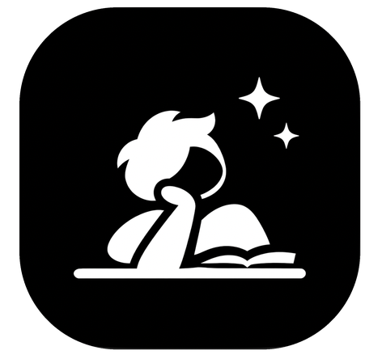
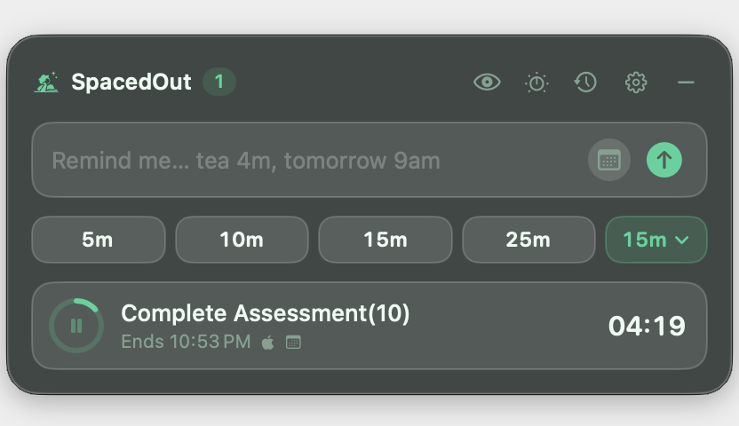
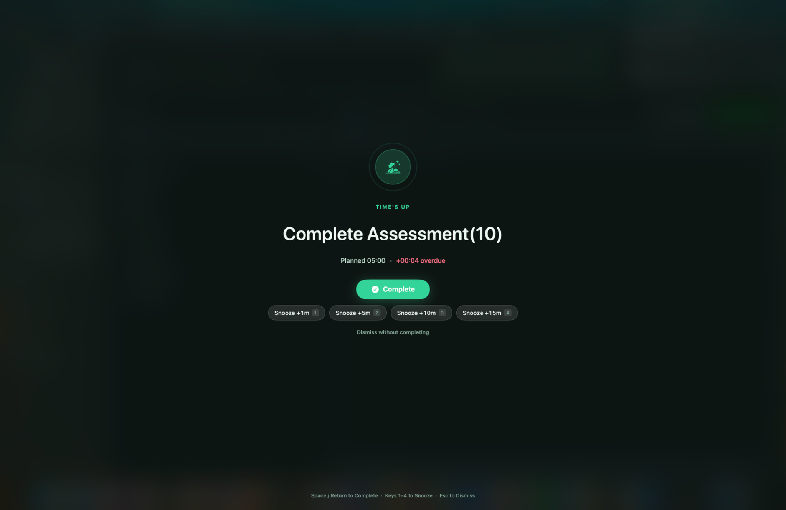
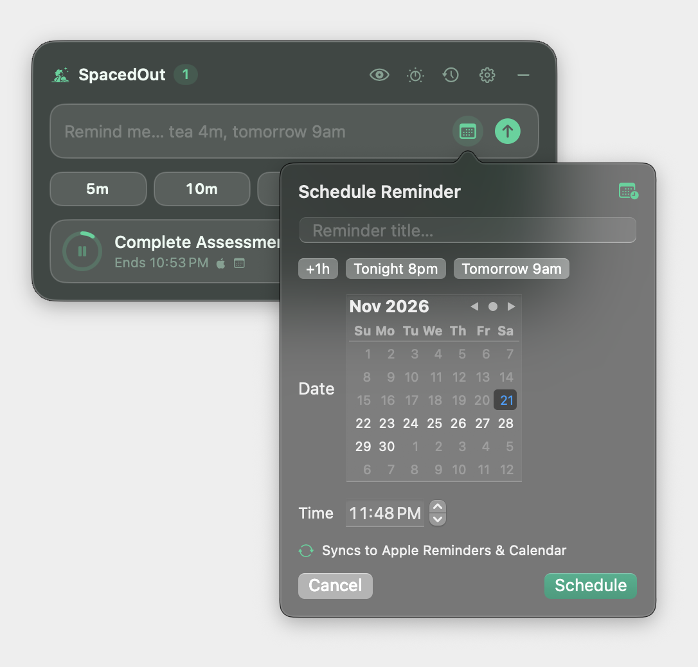

# SpacedOut

A native macOS reminder and timer app for capturing tasks quickly and keeping them visible until they're done.

<p align="center">
  
</p>

<p align="center">
  
  
  
</p>

SpacedOut is designed around a simple idea: reminders should be easy to create and difficult to overlook.

It combines quick natural-language input, countdown timers, scheduled reminders and a floating desktop widget. When a reminder is due, the app can display a full-screen alert rather than relying solely on a notification that might go unnoticed.

Built with Swift, SwiftUI and AppKit.

**[Download the latest release](https://github.com/gagankishoreint-glitch/SpacedOut/releases/latest)** · Requires macOS 14.0+

---

## Screenshots

Floating widget

<p align="center">
  
</p>

Full-screen alert

<p align="center">
  
</p>

Scheduling reminders

<p align="center">
  
</p>
<!-- Add demo.gif here when a real application recording is available. -->

## Features

### Reminders and timers
- Create reminders using natural-language input.
- Support for countdown durations such as `tea 4m` and `1h30m deep work`.
- Schedule reminders for specific times, including `tomorrow 9am`.
- Quick duration presets and an adjustable rotary timer dial.
- Edit, complete, snooze and delete tasks.

### Desktop interface
- Floating widget and menu bar operating modes.
- Global keyboard shortcut (`⌥ Space` by default).
- Widget positioning that adapts to connected displays.
- Configurable appearance and notification behaviour.

### Alerts
- Full-screen alerts across connected displays.
- Synthesised audio and supported trackpad haptics.
- Keyboard controls for completing, snoozing and dismissing reminders.
- Presentation mode for using native macOS notifications instead.
- Optional pre-alert before a reminder expires.

### Apple integration
- Integration with Apple Reminders and Apple Calendar through EventKit.
- Synchronisation of supported changes through Apple's services.
- Calendar export using `.ics`.

Cross-device availability depends on the corresponding Apple account and iCloud synchronisation settings.

### History and recovery
- Searchable activity history.
- Focus and completion statistics.
- Atomic local persistence.
- Recovery of timers that expire while the Mac is asleep or powered off.
- LaunchAgent-based application recovery.
- Export activity history as `.txt`.

## Installation

1. Visit the [latest releases](https://github.com/gagankishoreint-glitch/SpacedOut/releases/latest).
2. Download `SpacedOut.dmg`.
3. Open the disk image and move `SpacedOut.app` into Applications.
4. Open the application.

**First launch:** Releases are currently ad-hoc signed and not notarised by Apple. macOS may prevent the application from opening initially. If this happens, use Finder to right-click the app, select **Open**, and confirm the warning.

If necessary, the quarantine attribute can be removed manually:

```bash
xattr -d com.apple.quarantine /Applications/SpacedOut.app
```

The application requests Reminders and Calendar permissions when those integrations are used.

## Building from source

### Requirements

- macOS 14.0 or later
- Xcode 15.3 or later
- Swift 5.10 or later

Clone the repository:

```bash
git clone
